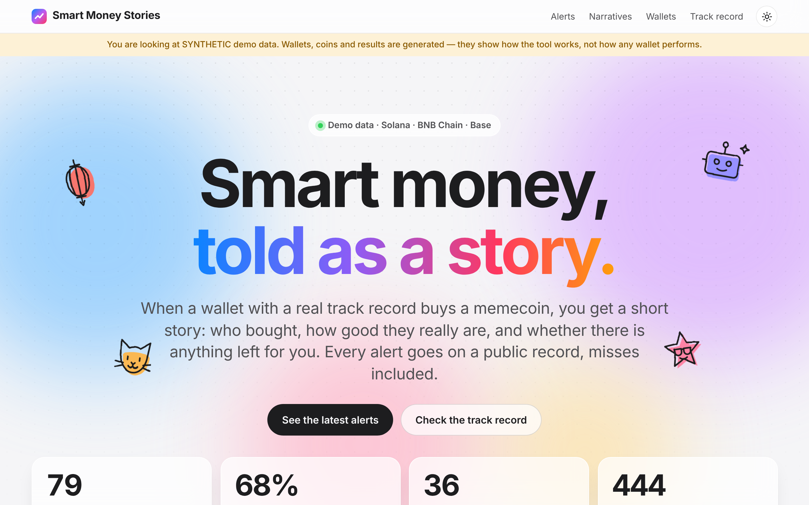
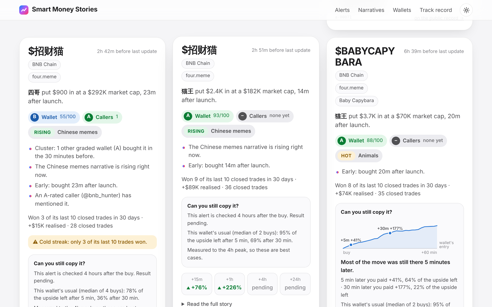
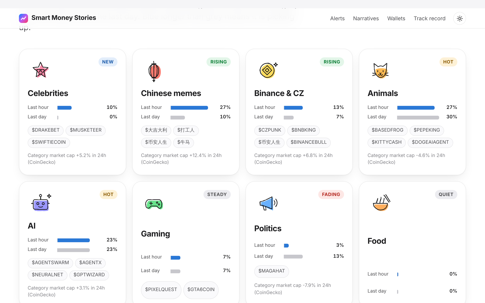
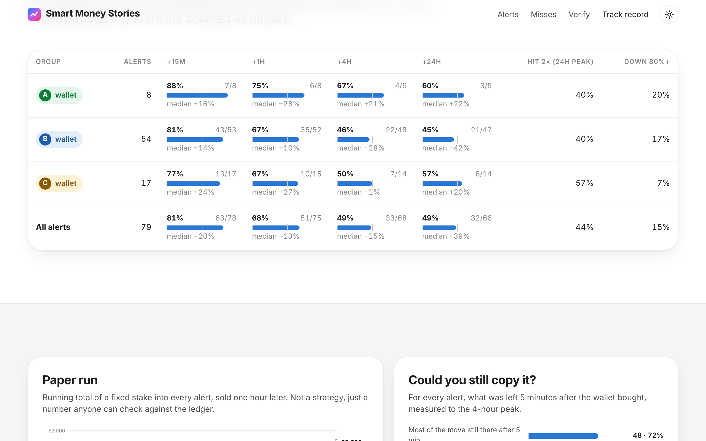
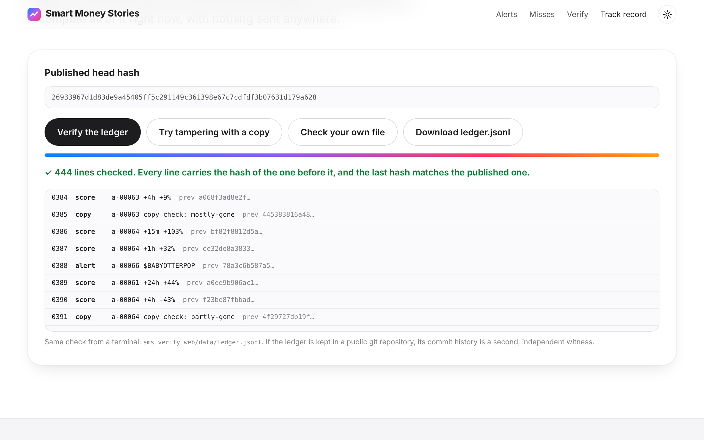
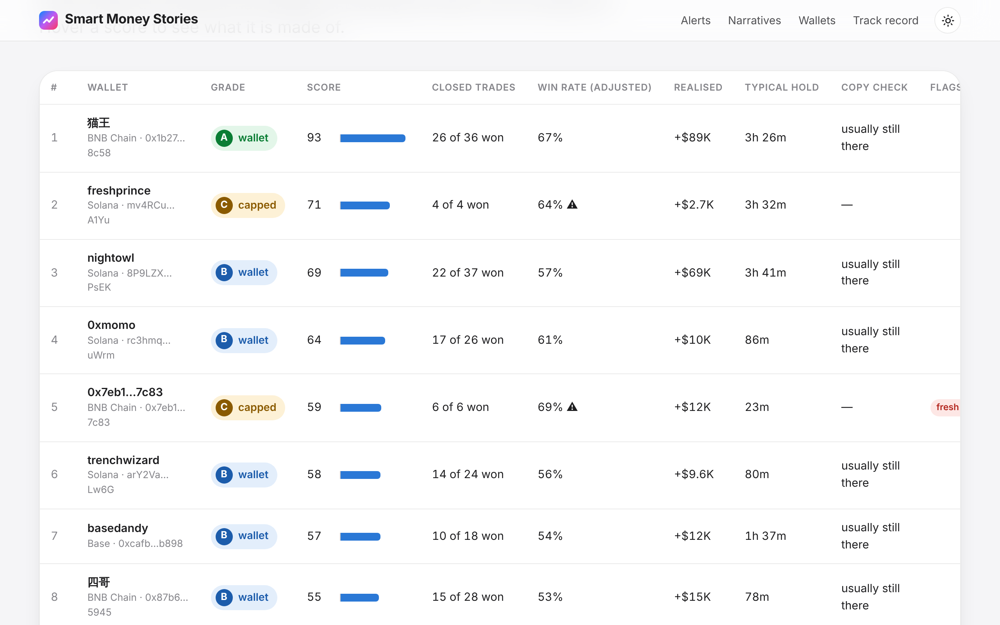
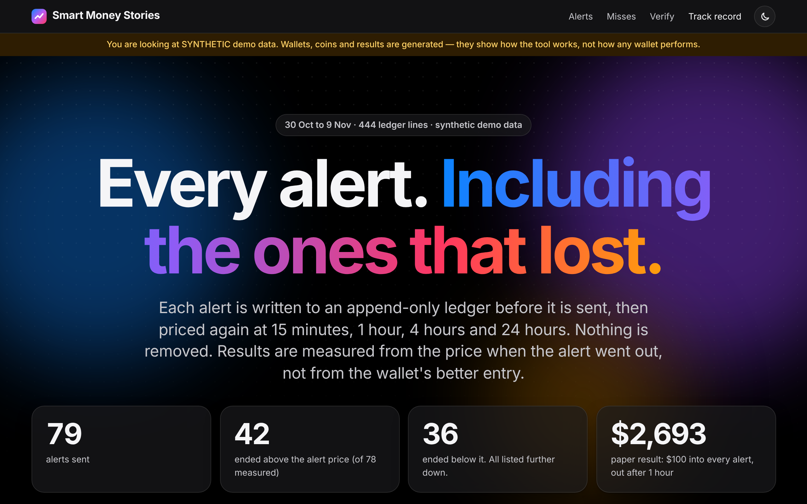
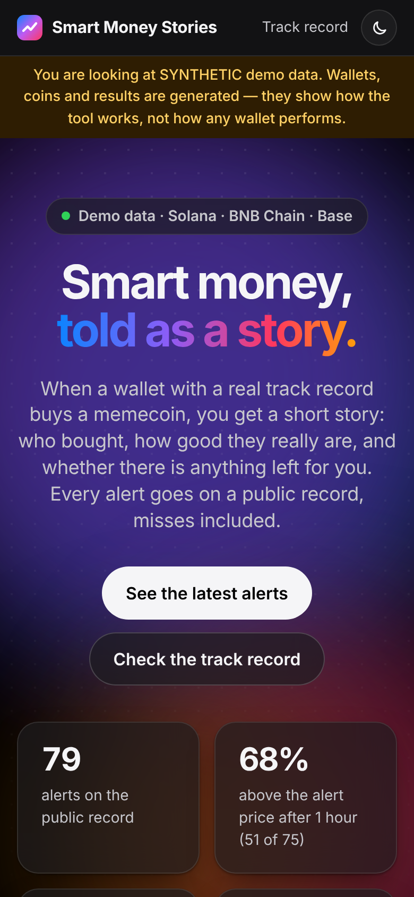

# Smart Money Stories

**Free, open-source memecoin alerts in plain English, on a record anyone can check.**

When a wallet with a real track record buys a memecoin, you get a short story: who bought, how
good they really are, and whether the coin's theme is heating up. The story is an observation.
Alerts only, not advice. We never tell you to buy or sell; trade decisions are yours.
Every alert is written to a hash-chained public ledger and priced again at
+15m, +1h, +4h and +24h. Misses stay on the record.

Solana and BNB Chain (including four.meme launches and Chinese-language names), Base optional.
MIT licensed. Runs on free data. **Read-only: it cannot trade.**

> **Not financial advice.** Memecoins are extremely risky and most go to zero. Past results of any
> wallet or caller do not predict future results. This tool only reads public data. It never asks
> for a wallet, private key or seed phrase, and there is no trading code in it.
> **Alerts only, not advice. We never tell you to buy or sell; trade decisions are yours.**



## Quick start (3 commands, no keys)

```bash
git clone -b smart-money-stories https://github.com/anishsaha282002-dotcom/smart-money-alerts && cd smart-money-alerts
```

```bash
pip install -e .
```

```bash
sms demo
```

`sms demo` runs the whole product on bundled **synthetic** data: it scans, grades, writes alerts
to a ledger, scores them, prints a sample alert and the track record, and fills the website. Then:

```bash
sms serve
```

and open http://localhost:8000.

To run it on real data, with or without keys:

```bash
cp .env.example .env
```

```bash
sms watch --interval 60
```

## What an alert looks like

This is real output of `sms demo` (synthetic data):

```text
🔵 B-grade wallet bought $招财猫 on BNB Chain · four.meme
四哥 put $900 in at a $292K market cap, 23m after launch.

WHY THIS ONE
• Cluster: 1 other graded wallet (A) bought it in the 30 minutes before.
• The Chinese memes narrative is rising right now.
• Early: bought 23m after launch.
• An A-rated caller (@bnb_hunter) has mentioned it.

WALLET GRADE: B (55/100)
Won 3 of its last 10 closed trades in 30 days (+$15K realised, typical hold 78m).
Sample: 28 closed trades (win rate adjusted for sample size: 53%).
⚠ Cold streak: the grade covers 30 days, but only 3 of its last 10 trades won.

CALLER GRADE: A
• @bnb_hunter — A: coins were +37% an hour after its calls (median of 22; +20% at 15m, +20% at 24h)

NARRATIVE: Chinese memes
RISING — takes a bigger share of the last hour than of the day.
27% of the last hour's trending coins vs 10% of the day's.

CAN YOU STILL COPY IT?
Its last 4 priced buys: most of the move was still there 5 minutes later.
• 5 min later you paid +5% vs the wallet, about 78% of the upside left.
• 30 min later you paid +11% vs the wallet, about 36% of the upside left.
Measured to the 4h peak, so these are best cases. This alert gets the same check on the record.

Alert a-00070 · SYNTHETIC DEMO DATA
Not financial advice. This tool cannot trade.
Alerts only, not advice. We never tell you to buy or sell; trade decisions are yours.
```

A wallet with too little history gets a warning instead of a confident grade:

```text
WALLET GRADE: C (71/100)
Won 4 of its last 4 closed trades in 30 days (+$2.7K realised, typical hold 3h 32m).
⚠ Tiny sample: only 4 closed trades. The grade is capped at C until there are 5.
```

## The five things it does

| | What | How |
|---|---|---|
| 1 | **Plain-English story alerts** | Fixed templates: same alert, same words, every number straight from the data. Optional LLM rewording with your own key; if the reworded text changes any number, ticker or grade, the template is sent instead. |
| 2 | **Three grades, never blended** | Wallet grade (A–D), caller grade, narrative momentum. Shown as three separate sections and three separate badges. There is no combined score. |
| 3 | **"Can you still copy it?"** | From free minute candles: what you would have paid 5 and 30 minutes after the wallet, and how much upside was left. Shown as the wallet's historical median and, once data exists, for the alert itself. Says "mostly gone" when it is. |
| 4 | **Solana and BNB Chain** | Includes four.meme pools and Chinese names and tickers (招财猫 is classified as a Chinese meme *and* an animal coin). Base is supported and off by default. |
| 5 | **Public, checkable record** | Append-only JSONL ledger, each line carrying the SHA-256 of the line before. Auto-scored at +15m, +1h, +4h, +24h. A stats page by grade that lists the misses. Verifier runs in your browser. Optional OpenTimestamps anchor. |



## Honest comparison with paid tools

Paid alert tools in this space cost real money: Tachyo is listed at $849 per 90 days and Blackroom
Alpha at $120 per month. I have not used or audited either, so this table does not claim what they
do or do not do. It says what this project does, and what is worth asking of any tool you pay for.

| Question | Smart Money Stories | Ask a paid tool |
|---|---|---|
| Price | $0, MIT licensed | — |
| Can I read how wallets are scored? | Yes, [`sms/grading/wallet.py`](sms/grading/wallet.py) is about 200 lines | Is the scoring method published? |
| Is there a record of every alert, including losers? | Yes, hash-chained, verifiable in the browser | Can I see the alerts that lost, and prove none were deleted? |
| Are results measured from a price I could have got? | Yes, from the alert-time price, not the wallet's entry | Which price are the advertised gains measured from? |
| Does it tell me when copying is too late? | Yes, the 5 and 30 minute copy check | — |
| Does it warn about small samples? | Yes, and caps the grade | — |
| Can it trade for me? | No, by design | — |

**Where a paid tool is very likely better, and this one is weaker:**

- **Speed.** Free APIs are rate-limited. A keyless scan takes minutes, not seconds. Paid tools
  usually run their own nodes and streams.
- **Coverage and labels.** Without a GMGN key, wallet history is only what this tool has itself
  seen. Paid tools often have years of labelled wallets.
- **Caller data.** X's free API tier has no search, so caller grades come from GMGN call-outs
  unless you pay X for API access.
- **Support and uptime.** This is a project you run yourself.

If you need the fastest possible alert, this is not it. If you want to understand why an alert
fired and check whether alerts like it have actually worked, that is what this is for.

## What works with no keys, and what each free key adds

| Setup | What you get |
|---|---|
| **Nothing** (`sms demo`) | The full product on synthetic data: alerts, grades, copy check, ledger, scoring, website. |
| **No keys** (`sms run`) | Live narrative board (GeckoTerminal, Jupiter, CoinGecko). Live wallet-attributed trades from the trade tape of trending pools and four.meme pools. Token lookups, minute candles, scoring, copy check, RugCheck and GoPlus warnings. **Limit:** a wallet's history is only what the tool has seen so far, so grades start at D and need days of running before anyone reaches B. |
| **+ `HELIUS_API_KEY`** | 30 days of swap history for Solana wallets you list in `config.toml`, so they are graded properly from the first scan. |
| **+ `GMGN_API_KEY`** | Smart-money and KOL trade feeds, 30-day wallet history, wallet tags (sniper, bundler, insider) and call-outs for caller grades, on Solana, BNB Chain and Base. This is the key that makes live mode useful on day one. |
| **+ `X_BEARER_TOKEN`** | Caller mentions and narrative post counts from X. Needs a paid X API tier. |
| **+ Telegram / Discord** | Alerts delivered to a chat or channel. |
| **+ `ANTHROPIC_API_KEY`** | Optional rewording of the alert text. Off by default. |

Every source is optional. One that is missing, down or rate-limited is skipped with a single
warning and the rest of the scan carries on. `sms sources` shows what is switched on.

### Getting the free keys

- **Helius** — sign up at https://dashboard.helius.dev, copy the API key. The free tier is enough.
- **GMGN** — create an API key at https://gmgn.ai/ai. Their form asks for an Ed25519 *public* key.
  Make a pair, paste the public part, and put only the API key they give you in `.env`:

  ```bash
  openssl genpkey -algorithm ed25519 -out gmgn_private.pem
  ```

  ```bash
  openssl pkey -in gmgn_private.pem -pubout
  ```

  The private file is only needed for GMGN's trading routes, which this project never calls.
  Do not put it in `.env`; you can delete it.
- **Telegram** — message [@BotFather](https://t.me/BotFather), send `/newbot`, copy the token.
  Add the bot to your chat or channel, then get the chat id from
  `https://api.telegram.org/bot<token>/getUpdates` after sending one message there.
- **Discord** — Channel settings → Integrations → Webhooks → New Webhook → Copy Webhook URL.
- **X** — https://developer.x.com. Search needs a paid tier; skip it unless you already have one.

All keys go in `.env` (see [`.env.example`](.env.example)). Nothing else is ever read for
credentials, and `.env` is git-ignored.

## Commands

| Command | What it does |
|---|---|
| `sms demo` | Run everything on bundled synthetic data. No keys, no network. |
| `sms run` | One live scan: new buys → alerts → score old alerts → refresh website data. |
| `sms watch --interval 60` | Scan forever. |
| `sms grade-wallet <address> --chain solana` | Grade one wallet and explain the score. Try `sms grade-wallet nightowl --demo`. |
| `sms score-ledger` | Price-check every alert that has reached a checkpoint. |
| `sms report` | Print the track record by grade, misses included. `--demo` for the demo ledger. |
| `sms verify [file]` | Check a ledger's hash chain. Exit code 1 if anything was changed. |
| `sms anchor` | Write today's head hash into the ledger; stamp it with OpenTimestamps if `ots` is installed. |
| `sms sources` | Show which data sources are on. |
| `sms serve` | Preview the website locally. |

Settings live in [`config.toml`](config.toml): chains, minimum grade, minimum buy size, cooldown,
grading constants, the wallets to follow.

## How it works

```mermaid
flowchart LR
  subgraph Free data, read-only
    GT[GeckoTerminal<br/>trending · four.meme · trades · candles]
    DS[DexScreener]
    JUP[Jupiter<br/>trending + organic score]
    CG[CoinGecko<br/>categories]
    HEL[Helius<br/>optional key]
    GMGN[GMGN OpenAPI<br/>optional key, read routes only]
    X[X API<br/>optional]
    SAFE[RugCheck · GoPlus]
  end

  GUARD{{HTTP guard<br/>refuses any trade,<br/>order or sign request}}
  GT & DS & JUP & CG & HEL & GMGN & X & SAFE --> GUARD --> HUB[Hub<br/>every source optional]

  HUB --> PIPE[Pipeline]
  PIPE --> WG[Wallet grade A–D]
  PIPE --> CGR[Caller grade]
  PIPE --> NM[Narrative momentum]
  PIPE --> CC[Copy check<br/>+5m / +30m]
  WG & CGR & NM & CC --> STORY[Story<br/>fixed template]

  STORY --> LEDGER[(Ledger JSONL<br/>sha256 chain)]
  LEDGER --> OUT[Console · Telegram · Discord]
  LEDGER --> SCORE[Scorer<br/>+15m +1h +4h +24h]
  SCORE --> LEDGER
  LEDGER --> SITE[Static website<br/>alerts · board · leaderboard · record · verifier]
```

The alert is written to the ledger **before** it is delivered, so nothing can be sent that is not
on the record.

### Wallet grade

Out of 100, from closed trades in the last 30 days:

| Part | Points | Notes |
|---|---|---|
| Win rate | 40 | Shrunk toward 50% as if 10 coin-flip trades were added. 4 wins from 4 counts as 64%, not 100%. |
| Return on cost | 30 | Realised profit ÷ money put in, shrunk the same way. |
| Spread | 20 | How much of the profit does not rest on a single trade. |
| Hold time | 10 | Seconds-long holds score zero. |
| Penalties | −10 to −30 | Bot, wash trading, bundler, fresh-funded cluster, insider tag, sniper. |

A ≥ 75, B ≥ 50, C ≥ 35, D below. Three rules worth knowing:

- Only **closed** trades count. Paper gains are not a record.
- A position bought more than 7 days ago and never sold counts as a **full loss**. Otherwise a
  wallet that only sells its winners would look perfect.
- Fewer than 5 closed trades, or any serious flag, **caps the grade at C**.

### Caller grade

Every mention of a coin by a caller is stored with the price at that moment. A day later the
scorer writes down the price 15 minutes, 1 hour and 24 hours after the mention. A caller's grade
uses only aged calls: hit rate at 1 hour (shrunk toward 50%) and the median move. Fewer than 3
aged calls shows as "unrated".

### Narrative momentum

Coins are sorted into themes by keywords in English and Chinese. Momentum compares two trending
lists taken at the same moment: the last hour and the last day. A theme with a bigger share of
the hour than of the day is **rising**; absent from the day and present now is **new**; a large
steady share is **hot**; a shrinking share is **fading**.



### Copy check

From minute candles after the wallet's buy, over a 4-hour window:

- **entry** — how much more you paid 5 and 30 minutes later
- **left** — the best you could still have reached from there
- **kept** — the share of the wallet's own upside still on the table

Everything is measured to the peak, which nobody sells at. So these are ceilings: if even the
ceiling says "mostly gone", it was gone.

### The ledger

```text
{"seq":0,"type":"alert","ts":…,"id":"a-00001",…,"prev":"0000…0000"}
{"seq":1,"type":"score","ts":…,"alert_id":"a-00001","h":"15m","status":"ok","x":1.0566,…,"prev":"<sha256 of line 0>"}
```

- Nothing is rewritten. A price check on an old alert is a **new line** pointing at it.
- Change, delete or insert any earlier line and `sms verify` (and the verifier on the site) says
  which line broke.
- The last line has nothing after it, so the **head hash** is published with the site and written
  into a daily `anchor` line. `sms anchor` can stamp it with OpenTimestamps.
- A checkpoint where nobody traded any more is recorded as `quiet` and counted as a miss. One with
  no price data is recorded as `no_data` after six hours, so it cannot be retried until a nicer
  number turns up.




## The website

Plain static files in [`web/`](web/): no build step, no framework, no third-party scripts or
fonts. It reads `web/data/site.json` and `web/data/ledger.jsonl`, which `sms run`, `sms watch`
and `sms demo` write. Light and dark mode, mobile friendly.

| Leaderboard | Dark mode | Phone |
|---|---|---|
|  |  |  |

The repository ships with the synthetic demo data in `web/data/`, labelled as such on every page,
so a fresh deploy shows a working site.

### Host it free

- **GitHub Pages** — Settings → Pages → Source: "GitHub Actions". The included
  [`pages.yml`](.github/workflows/pages.yml) publishes `web/` on every push that changes it.
- **Vercel / Netlify / Cloudflare Pages** — import the repository and set the root (publish)
  directory to `web`. No build command.

### Optional: a free scanner on GitHub Actions (nothing to install)

[`scan.yml`](.github/workflows/scan.yml) runs `sms run` every 30 minutes on GitHub's servers,
commits the ledger, and publishes the website with fresh data. You only ever open a link.

One-time setup, all in the repository's **Settings**:

1. **General → Default branch**: the branch that holds this project (scheduled workflows only run
   from the default branch).
2. **Pages → Source**: "GitHub Actions". The site appears at
   `https://<your-name>.github.io/<repository>/`, with the labelled demo data at first.
3. **Secrets and variables → Actions → Variables**: add `SMS_SCAN_ENABLED` = `true` to switch the
   live scanner on. From the next run the site shows live data instead of the demo.
4. Optional, **Secrets**: `GMGN_API_KEY`, `HELIUS_API_KEY`, `TELEGRAM_BOT_TOKEN`,
   `TELEGRAM_CHAT_ID`, `DISCORD_WEBHOOK_URL`.

Good to know: scheduled workflows are often late, so this suits a slow public record; for timely
alerts run `sms watch` on a machine that stays on. The ledger lives in `record/` in git, so commit
history is a second witness to it. The scanner's working memory is kept in the Actions cache.
These workflows are written for GitHub's documented behaviour but could not be run from the
environment this project was built in, so watch the first runs in the **Actions** tab.

## Safety

- **No trading code.** No swaps, orders, signing, private keys, seed phrases or wallet connections.
- **Enforced, not promised.** [`sms/sources/http.py`](sms/sources/http.py) refuses any request
  whose path looks like trading, ordering, signing or sending a transaction before it leaves your
  machine. [`tests/test_no_trading.py`](tests/test_no_trading.py) runs a full live scan and a full
  demo against a fake network and fails if a single trade endpoint is requested. It also scans the
  source for signing code and wallet libraries.
- **GMGN is read-only here.** Only its read routes are ported. The trade, order, strategy,
  token-creation and signed wallet routes are on a blocklist.
- **Keys come only from `.env`**, which you fill in and which is git-ignored.

## Project layout

```text
smart-money-stories/
├── sms/
│   ├── cli.py              commands
│   ├── config.py           .env + config.toml
│   ├── pipeline.py         scan → grade → alert → ledger → deliver
│   ├── scoring.py          +15m/+1h/+4h/+24h checks, copy check, caller ageing
│   ├── ledger.py           append-only JSONL with a sha256 chain
│   ├── report.py           track record by grade, site export
│   ├── story.py            the alert text (template + guarded LLM rewording)
│   ├── deliver.py          console, Telegram, Discord
│   ├── demo.py             the synthetic world for `sms demo`
│   ├── store.py            local SQLite working memory
│   ├── grading/            wallet.py · caller.py · narrative.py · copycheck.py
│   ├── sources/            http.py (guard) · hub.py · geckoterminal · dexscreener · jupiter
│   │                       coingecko · helius · gmgn (read-only) · xapi · safety
│   └── demo_data/          scenario.json
├── web/                    index.html · record.html · assets/ · data/
├── tests/                  133 offline tests with fixtures
├── .github/workflows/      ci.yml · pages.yml · scan.yml
├── config.toml · .env.example · pyproject.toml
└── LICENSE · NOTICE.md · CONTRIBUTING.md
```

## Known limitations

- **Keyless mode starts cold.** With no GMGN or Helius key, a wallet's record is only what this
  tool has observed. Expect no B-grade alerts for the first days. Lower `min_grade` to see alerts
  sooner, knowing they carry the "no closed trades" warning.
- **Slow on free limits.** GeckoTerminal allows about 30 requests a minute per IP, and often less
  from shared IPs. A keyless scan of two chains takes a few minutes.
- **Pool-tape addresses are not always people.** In keyless mode the buyer address comes from the
  transaction sender, which can be a router or bot contract. The bot and hold-time penalties catch
  many; not all.
- **Helius dollar values are approximate.** SOL legs are converted at today's SOL price.
- **Bundle and fresh-cluster detection relies on source tags** (GMGN) or funding data you supply.
  There is no on-chain funding-graph crawler yet.
- **Copy check is a best case.** It measures to the peak and ignores slippage, fees and taxes.
- **The demo is synthetic.** Its good wallets were given better odds on purpose. Nothing about real
  performance can be read from the demo record.
- **What was tested live and what was not.** Verified against the real APIs while building:
  GeckoTerminal, DexScreener, Jupiter, CoinGecko and RugCheck, including a full keyless scan that
  wrote real alerts and scored them 15 minutes later. GMGN's smart-money and KOL response shape was
  checked once against the real API; the Python client for it, and the Helius, X, GoPlus, Telegram,
  Discord and LLM paths, are tested with fixtures and fake transports only, because no keys were
  available. Expect to fix small things when you first plug a real key in.
- **Jupiter's free endpoint has moved before.** Its base URL is a setting (`jupiter_base`).

## Credits

Built on [cvxv666/fomo-robinhood-radar](https://github.com/cvxv666/fomo-robinhood-radar) (MIT):
its rate limiter, GeckoTerminal and Helius clients, Telegram sender and "paper run with the misses
kept" record were adapted. The GMGN client is a read-only Python port of
[GMGNAI/gmgn-skills](https://github.com/GMGNAI/gmgn-skills) (MIT). Two thresholds follow
[h100envy/crawl-hive](https://github.com/h100envy/crawl-hive) (MIT). Details in
[NOTICE.md](NOTICE.md).

## License

[MIT](LICENSE).
