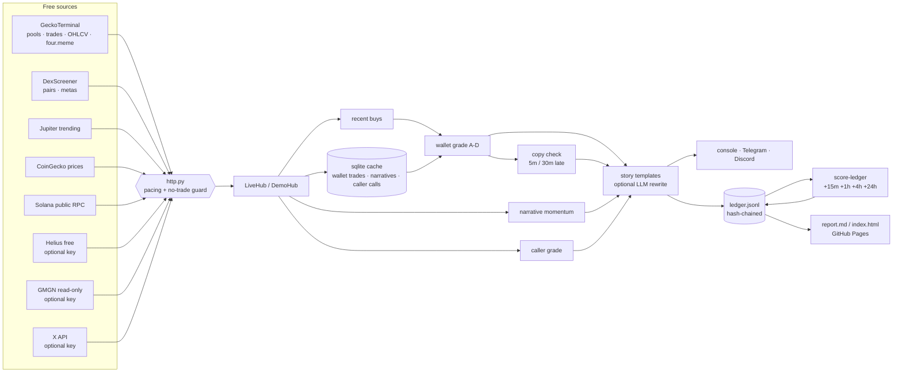

# smart-money-alerts

**Free, open-source (MIT), read-only memecoin smart-money alerts that explain themselves and keep a public, tamper-evident scorecard.**

When a graded wallet buys a memecoin on **Solana** or **BSC (including four.meme)**, `sma` sends one short, plain-English message that combines:

1. **The wallet's story**: its grade (A–D), track record ("won 8 of last 10 closed trades over 30d"), sample size with an explicit low-sample warning, and why this buy is interesting.
2. **Three separate grades in one message**: wallet grade, caller grade (X/Twitter chatter from tracked callers) and narrative momentum (NEW / RISING / HOT / FLAT / FADING).
3. **"Can you still copy it?"**: the wallet's past buys replayed through free OHLCV candles, giving the median gain left if you had bought **5 or 30 minutes late**, compared with buying at the wallet's price.
4. **Solana + BSC/four.meme**, with Base optional.
5. **A public alert ledger**: append-only JSONL, every line hash-chained to the one before it, scored automatically at +15m/+1h/+4h/+24h. A static report (misses included) can be served from GitHub Pages.

> **It never trades.** There is no buy, sell, swap, order, signing or private-key code. An HTTP guard refuses trading and signing endpoints at runtime, and a test fails the build if trading code or a trading subcommand ever appears. It is a research tool. **Not financial advice.**

## Sample alert (from `sma demo`, synthetic data)

```
SMART-MONEY BUY · $AGENTZ on Solana · alert #0
Wallet DemoAce — grade A (80/100) bought $2.4K 7m ago.
Record: won 8 of last 10 closed trades over 30d (11/14 overall); sample-adjusted win rate 68%; median closed trade +48%, typical hold 40m (n=14 closed, data: demo fixture).
Why it's interesting: first time this wallet has bought this token; 1 other graded wallet(s) (B) bought it in the last 60m; token is only 3.0h old; its narrative 'AI/agents' is HOT; GMGN tag: smart_degen.
Can you still copy it? Price is +12% since its buy 7 min ago. Replaying its last 6 trades: at its price median +47%, 5 min late +25%, 30 min late +6% — historically still worth it 5 min late.
Caller chatter: grade B — 2 tracked caller(s): @demo_alpha_caller (B, 53% sample-adjusted 2x-rate, n≈13), @demo_beta_caller (C, 41% sample-adjusted 2x-rate, n≈10); 33 posts total.
Narrative: AI/agents — HOT (momentum 22.2, 6 tokens, $957.0K 1h volume).
Risk: liquidity $85.0K, mcap $765.0K. Prices before fees/slippage. Not financial advice.
ledger #0 · 82f45f9c6792
```

The demo also produces a four.meme alert from a wallet that is grade A but **historically not worth copying 5 minutes late**, because it flips within about 8 minutes. That is exactly the case a raw "smart wallet bought" ping hides.

## Quick start (3 commands, zero keys)

```bash
git clone <this repo> smart-money-alerts && cd smart-money-alerts
python3 -m venv .venv && . .venv/bin/activate && pip install -e .
sma demo        # bundled fixtures: run -> score 25h later -> report -> verify; opens nothing online
```

Then open `demo-out/site/index.html`. For live data:

```bash
cp .env.example .env      # optional keys, see below
sma sources               # shows which sources are active
sma run                   # one pass; alerts go to console (+ Telegram/Discord if configured)
sma watch --interval 15   # run + score-ledger every 15 minutes
sma score-ledger          # append due +15m/+1h/+4h/+24h outcomes
sma report                # build public/index.html + public/report.md
sma verify-ledger         # check the hash chain
sma grade-wallet <address> --chain solana --late   # explain one wallet, with the copy check
sma anchor                # write today's head hash (for OpenTimestamps)
```

## What works without keys, and what a free key adds

| Capability | Keyless | With a free key |
|---|---|---|
| Discover active wallets: recent trades (with wallet addresses) on trending Solana/BSC pools and four.meme pools | ✅ GeckoTerminal | — |
| Token → pool, liquidity, market cap | ✅ DexScreener | — |
| OHLCV for the copy check and ledger scoring | ✅ GeckoTerminal (minute candles, ~30 calls/min) | — |
| Narrative momentum | ✅ GeckoTerminal, DexScreener metas, Jupiter trending | — |
| SOL/BNB → USD | ✅ CoinGecko | — |
| Solana wallet history for grading | ⚠️ public RPC: works but slow and budgeted. Busy wallets only get their last few dozen swaps, so the grade carries a "history covers only Xh" warning | ✅ **Helius** free plan (`HELIUS_API_KEY`): prefers the Parsed Streams SQLite from `stream_worker.py` when it is fresh; otherwise Parsed Events history (~10 credits/request). The 100-credit Enhanced Transactions endpoint is not used. |
| BSC/Base wallet history | ⚠️ only trades this tool has observed itself (grows each run, so mostly "U" at first) | ✅ **GMGN** read-only (`GMGN_API_KEY`): `wallet_activity` |
| Curated smart-money / KOL buy feed (SOL, BSC, Base) | ✅ Solana: watch list in `data/wallets.json` (cluster = 2+ tracked wallets in ~1h; KOL-buy from wallets tagged `kol`). BSC stays on GeckoTerminal / four.meme | ✅ **GMGN** `/v1/user/smartmoney`, `/v1/user/kol` (optional; dormant without a key) |
| Caller grade from X chatter | ❌ message says "not checked" | ✅ **X API** bearer token (`X_BEARER_TOKEN`) |
| Telegram / Discord delivery | console only | `TELEGRAM_BOT_TOKEN` + `TELEGRAM_CHAT_ID`, `DISCORD_WEBHOOK_URL` |
| LLM narration | deterministic templates (default) | any OpenAI-compatible endpoint (`LLM_API_KEY`, `narration.llm: true`) |

### Getting the free keys (you do this; the tool never signs up for anything)
- **Helius**: create a free account at <https://dashboard.helius.dev>, copy the API key, and put it in `HELIUS_API_KEY`. Run the `tracker/stream_worker.py` (Parsed Streams, Free plan) so `sma run` can read `helius_swaps.db`. Set `HELIUS_STREAM_DB` if the database is not at the default `tracker/helius_swaps.db` path. Without a live worker, this tool polls Parsed Events history instead.
- **GMGN**: the Agent API at <https://gmgn.ai/ai>; docs and the official MIT client are at <https://github.com/GMGNAI/gmgn-skills>. Only the read-only "exist auth" `GMGN_API_KEY` is used. **Do not** set `GMGN_PRIVATE_KEY`; this tool never reads it and only calls a whitelist of read endpoints.
- **X API**: a developer-portal bearer token. Recent search on the free tier is very limited, so the per-run budget defaults to 10 calls. Any object with a `posts_about(symbol, address)` method can replace the X source.
- **Telegram**: make a bot with @BotFather and use your chat id. **Discord**: Channel → Integrations → Webhooks.

## How the grades work

**Wallet grade (A–D, or U = ungraded)**, in `src/sma/grading/wallet.py`, inspired by the public methodology write-ups of Stable Boy and MadeOnSol (this is not a reimplementation of either):
- Positions are rebuilt per token from buys and sells. A position is *closed* once at least 90% of its peak size has been sold. Only closed positions in the 30-day window count, so open "moonbags" can't flatter a wallet.
- The win rate is **shrunk toward 50%**: `(wins + k/2) / (n + k)` with k = 8, so a 3-for-3 wallet scores 64%, not 100%.
- `score = 50 + 50·(0.5·win_edge + 0.3·tanh(median_return/0.5) + 0.2·tanh(ln profit_factor))`, minus penalties for **bot-like** behaviour (median hold under 30 s or more than 300 trades a day, −25), **wash-like** trading (many flat round trips under 2 minutes, −20) and **bundle/sniper-like** buying (most first buys within 5 s of launch, −15).
- A ≥ 75, B ≥ 62, C ≥ 50, else D. Fewer than 5 closed trades gives a **LOW SAMPLE** warning and caps the grade at C. Fewer than 10 gives a "small sample" note. Fewer than 3 is U, which never alerts.

**Caller grade (A–D)**, in `grading/caller.py`: each tracked caller in `data/callers.json` (English and Chinese BSC callers) gets a 2x-within-24h hit rate. That rate is measured by this tool on the calls it detects, scored by `sma score-ledger`. Until enough calls are tracked, a published "NN% of MM" figure in the caller's note acts as a weak prior at one-third weight, and everything is shrunk toward a 30% base rate. Three or more independent tracked callers move the grade up one step.

**Narrative momentum**, in `grading/narrative.py`, adapted from the bundled `tracker/`: tokens from the free feeds are clustered into narratives using an English and Chinese seed map plus emergent keywords. Each narrative is scored on breadth, 1h volume, price change and token youth, then labelled against its own history.

**Copy check**, in `latecheck.py`: for up to N recent closed positions, it takes candle closes at the buy minute, +5m and +30m, and at the wallet's exit (or +4h if the position is still open). The copier exits when the wallet exits. If the wallet was already out before you could get in, that trade counts as 0% and is reported as "already out within 5 min". All figures are before fees and slippage.

## The public ledger

`public/ledger.jsonl` is append-only. Each line is canonical JSON (sorted keys, compact) whose `prev` field is the **sha256 of the previous line's exact bytes**. The first line uses 64 zeros. Scores are *new lines* that reference the alert id, so nothing is ever rewritten. Editing, deleting or reordering any line breaks every later `prev`. `sma verify-ledger` names the first bad line, and the report repeats a one-line Python check that needs nothing from this project.

To make history publicly checkable:
1. Commit `public/` and enable GitHub Pages on that folder (the CI workflow has an optional scheduled job that runs, scores, reports and commits).
2. Optionally anchor each day's head hash in Bitcoin for free with [OpenTimestamps](https://opentimestamps.org): `sma anchor && pip install opentimestamps-client && ots stamp public/anchors/$(date -u +%F).txt`. Commit the `.ots` file; anyone can later run `ots verify`. This is the same pattern SmugCalls uses for its CC0 call data.

The report groups results by wallet grade, caller grade, narrative status and chain (1h and 24h win rate and median, plus 24h return if 5 or 30 minutes late) and lists **every** alert, misses included.

## Architecture



## How it compares (honestly)

This project was built after a scan of about 40 tools (see [docs/COMPETITORS.md](docs/COMPETITORS.md)). No single tool we found combined all five pieces above, but the paid tools have real advantages this one does not:

| | smart-money-alerts | Tachyo (~$849 / 90 days) | Blackroom Alpha (~$120/mo) | GMGN (free, trade fees) | Cielo (free / $59 Pro) |
|---|---|---|---|---|---|
| Cost | free, MIT, self-hosted | paid | paid | free to view | freemium |
| Wallet universe | your watch list, wallets seen on trending pools, and GMGN's lists if keyed | 750k+ graded wallets | curated by operators | very large | large |
| Plain-English wallet story pushed per alert | ✅ templates | on request (analyst) | human-written in places | AI narration of tokens | raw data |
| Wallet + caller + narrative grades in one message | ✅ | ❌ | separate channels | separate features | ❌ |
| 5m / 30m late-entry figure per alert | ✅ from that wallet's history | "too late?" verdict | ❌ | ❌ | ❌ |
| four.meme BSC + Solana | ✅ | partial | partial | ✅ | partial |
| Public, hash-chained ledger | ✅ | public record | graded radar | ❌ | ❌ |
| Latency / polish / support | polling every few minutes; CLI | real-time, polished UI | real-time, community | real-time apps | real-time bots |

Tool descriptions come from their public pages as of November 2026 and may have changed since. They have far bigger data coverage, real-time infrastructure and teams behind them. This tool's claim is narrower: it is **transparent, reproducible and free** for the five features above.

## Project layout

```
src/sma/
  cli.py            sma command (read/report commands only)
  safety.py         runtime no-trade guard + allowed command list
  http.py           stdlib HTTP, per-host pacing, retries, guard on every request
  config.py         config.yaml + .env loading
  hub.py            LiveHub (free sources) and DemoHub (fixtures)
  pipeline.py       run / score-ledger orchestration
  grading/          wallet.py · caller.py · narrative.py
  latecheck.py      copy check (5m / 30m late)
  story.py          deterministic templates (+ optional LLM rewrite)
  ledger.py         hash-chained JSONL + verify
  report.py         static Markdown/HTML report
  notify.py         console · Telegram · Discord
  sources/          geckoterminal · dexscreener · jupiter · coingecko · solana (RPC + Helius) · gmgn · xapi
  fixtures/demo/    synthetic demo data (fictional wallets/handles)
data/  wallets.json (public leaderboard wallets to watch) · callers.json (X callers to grade)
tests/ pytest suite incl. safety tests and recorded API samples
scripts/make_demo_fixtures.py
```

## Known limitations

- **Pump.fun Callout Rewards.** `data/pumpfun_callout_leaderboard.json` is a dated public snapshot (daily/weekly/monthly/all-time). It is merged into caller grades as a boost beside the 24h-2x hit rate. Post-10 Oct 2026 windows outweigh all-time. A call or a board rank alone never creates an alert.
- **Streaming when the worker is up.** Solana tracked-wallet swaps come from the Helius Parsed Streams worker (`helius_swaps.db`) when its heartbeat is fresh; otherwise `sma run` cheap-polls Parsed Events. BSC/four.meme stays on GeckoTerminal. Caller chatter stays on the official X bearer / built-in X reads — not opentwitter-mcp.
- **Keyless grading is thin.** The public Solana RPC is rate-limited, and famous wallets are flooded with failed spam transactions. Without Helius, many wallets end up U or carry a partial-history warning. Without GMGN, BSC and Base wallets are only graded from trades this tool has observed itself.
- **Values are in the trade's own unit** (USD from GeckoTerminal/GMGN, SOL from RPC/Helius). Token-account rent is counted as buy cost, and fees and slippage are ignored.
- **OHLCV granularity.** Minute candles mean the "at buy" price is a candle close unless the source gives a fill price. Pools with gaps over 6 hours are skipped.
- **The X free tier is tiny.** The caller grade is often "not checked". Caller priors from `callers.json` are third-party, unaudited figures and are weighted down accordingly.
- **Heuristic penalties.** The bot, wash and sniper detection is simple and will misfire sometimes.
- **The free-tier GMGN and X endpoints and their response formats can change.** The parsers follow GMGN's official MIT client and are covered by tests, but were not exercised against the live keyed APIs while this was being built.
- In CI, the sqlite cache does not persist between scheduled runs unless you add a cache step.

## Disclaimer

This software is for research and education. It does not give financial advice, does not trade, and cannot move funds. Memecoins are extremely risky: most go to zero, "smart" wallets stop being smart, and alerts arrive after the wallet has already bought. Past performance in the ledger does not predict future results. Use at your own risk.
